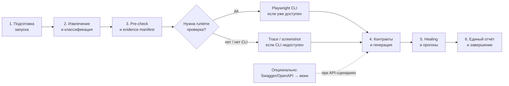

# Flow автоматизации тестов

Процесс разделён на шесть основных итераций. Каждая итерация имеет собственную
диаграмму, описание результата и ссылки на соседние шаги. Установка пакетов и
инициализация CLI намеренно не являются частью этой схемы.

## Итерации

1. [Подготовка запуска](tests-flow/01-prepare.md)
2. [Извлечение и классификация кейсов](tests-flow/02-extract-classify.md)
3. [Pre-check и evidence manifest](tests-flow/03-precheck-generate.md)
4. [Контракты и генерация тестов](tests-flow/03-precheck-generate.md)
5. [Healing и тестовые прогоны](tests-flow/04-heal-run.md)
6. [Единый отчёт и завершение](tests-flow/05-report.md)

Все итерации обновляют единый отчёт:
`autotest-cli-data/reports/<timestamp>/tests-automatization-report.md`. Если API-моки
нужны для сценария, перед их генерацией выполняется отдельная контрактная ветка:
`swagger-parser` → `playwright-mock-generator`.

## Evidence manifest

Между pre-check и генерацией flow создаёт компактную таблицу доказательств. Каждое действие и
ожидаемый результат TestIt-кейса связываются с исходной строкой TestIt, фактическими данными
проекта (код, runtime UI, существующий тест или OpenAPI-контракт) и будущим Playwright assertion.
Пункты без доказательств не превращаются в зелёные тесты: они остаются `test.fixme` или
фиксируются как непокрытые.

Для runtime-проверки Playwright CLI используется только если уже найден локально или в `PATH`.
Flow не устанавливает `@playwright/cli` сам и не меняет настройки registry. При его отсутствии
используются обычные артефакты Playwright: trace и screenshot.
