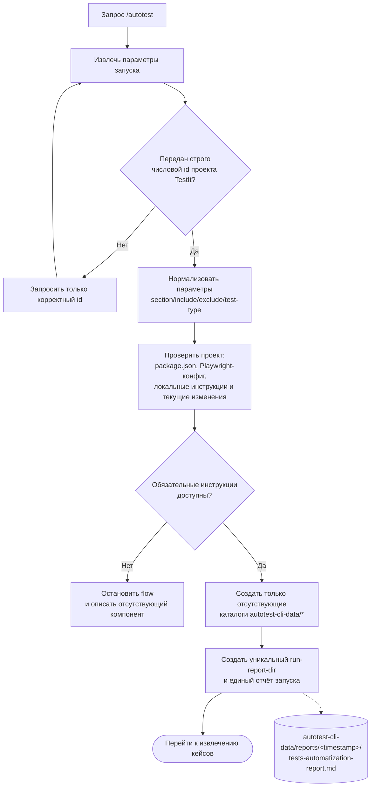

# Итерация 1. Подготовка запуска

[К обзору](../tests-flow.md) · [Следующая: извлечение и классификация →](02-extract-classify.md)

**Результат итерации:** получен корректный `id`, применены значения по умолчанию,
проверены обязательные инструкции и существующее окружение, создан уникальный каталог
единого отчёта. Установка пакетов в этот flow не входит.

[К обзору](../tests-flow.md) · [Следующая: извлечение и классификация →](02-extract-classify.md)
