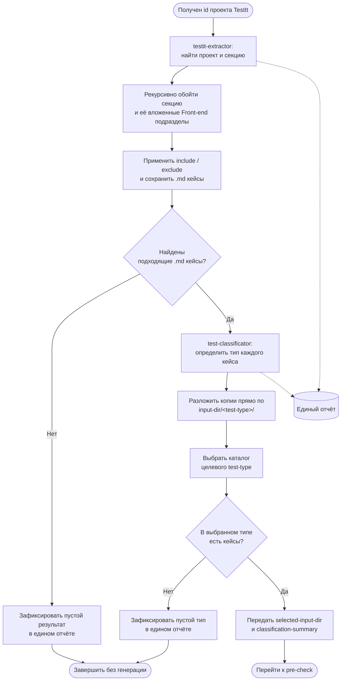

# Итерация 2. Извлечение и классификация кейсов

[← Предыдущая: подготовка](01-prepare.md) · [К обзору](../tests-flow.md) · [Следующая: pre-check и генерация →](03-precheck-generate.md)

**Результат итерации:** извлечённые кейсы классифицированы по типам тестирования;
для следующих этапов используется только непустой каталог выбранного типа, например
`autotest-cli-data/test-cases/testit/integration/`.

[← Предыдущая: подготовка](01-prepare.md) · [К обзору](../tests-flow.md) · [Следующая: pre-check и генерация →](03-precheck-generate.md)
