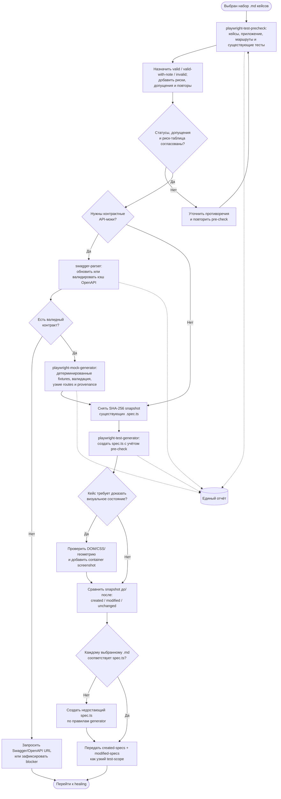

# Итерация 3. Pre-check, контракты и генерация тестов

[← Предыдущая: извлечение и классификация](02-extract-classify.md) · [К обзору](../tests-flow.md) · [Следующая: healing и прогоны →](04-heal-run.md)

**Результат итерации:** есть согласованный pre-check со статусами и рисками; каждому
выбранному кейсу соответствует `spec.ts`, а узкий scope строится только из созданных или
изменённых тестов. Ветка Swagger/OpenAPI выполняется лишь когда для сценариев действительно
нужны контрактные моки.

[← Предыдущая: извлечение и классификация](02-extract-classify.md) · [К обзору](../tests-flow.md) · [Следующая: healing и прогоны →](04-heal-run.md)
