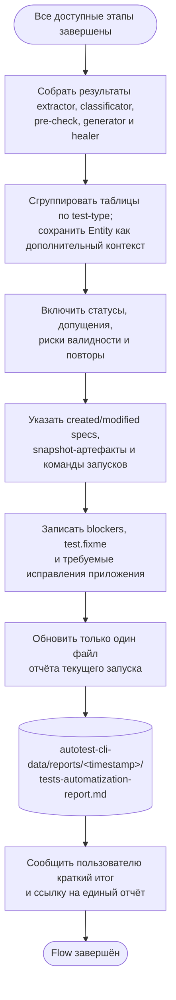

# Итерация 5. Единый отчёт и завершение

[← Предыдущая: healing и прогоны](04-heal-run.md) · [К обзору](../tests-flow.md)

**Результат итерации:** один отчёт текущего запуска содержит все обязательные разделы,
сгруппированные по типам тестирования; отдельные отчёты подскиллов не создаются.

[← Предыдущая: healing и прогоны](04-heal-run.md) · [К обзору](../tests-flow.md)
